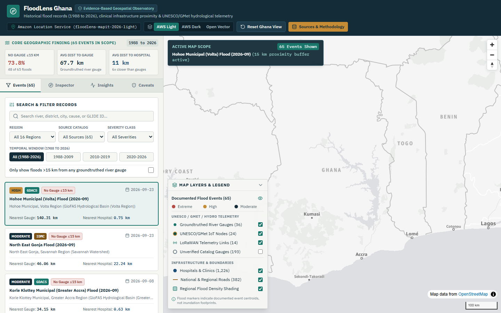
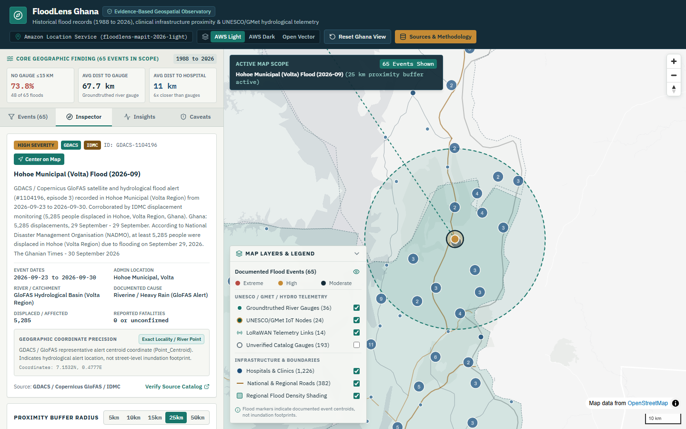
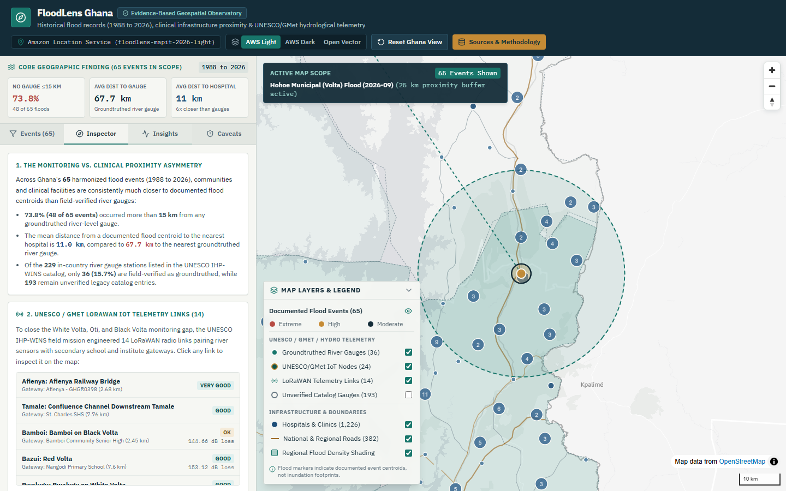
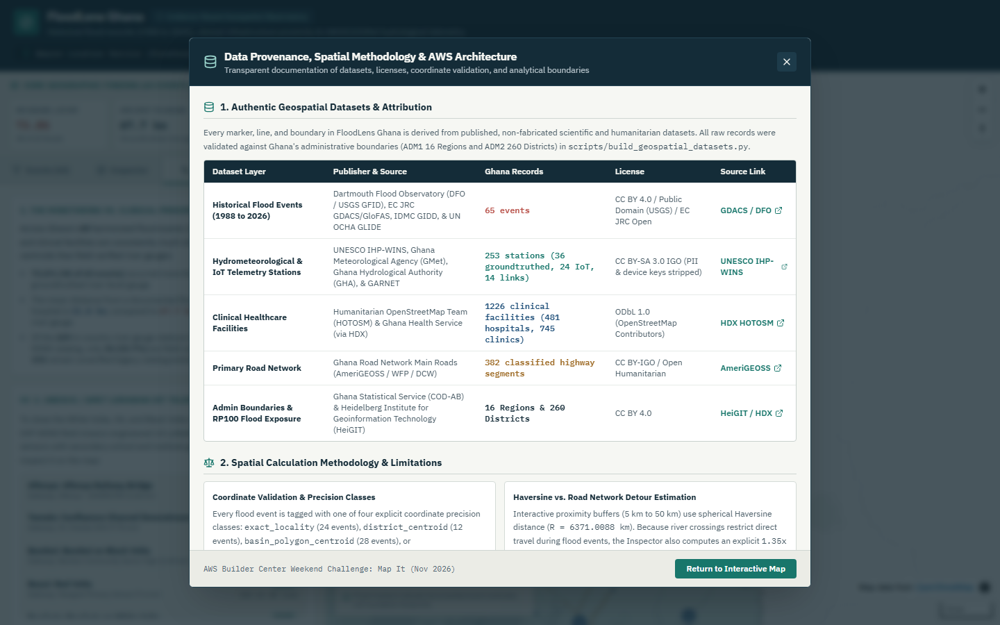
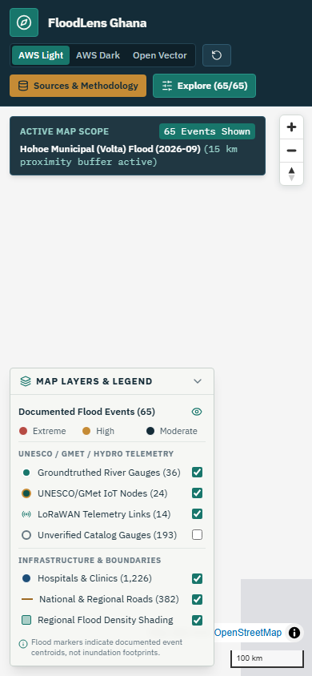
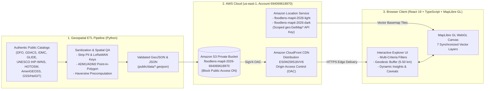

# FloodLens Ghana

**Evidence-Based Geospatial Observatory for Historical Flood Events, Clinical Infrastructure Proximity, and UNESCO/GMet Hydrological Telemetry in Ghana**

Built for the **[AWS Builder Center Weekend Challenge: Map It](https://builder.aws.com/build/hackathons/e7a301ea-4d84-3b9e-95be-7340a70f7781/weekend-challenge-map-it)**

- **Live Public Application (Amazon CloudFront + S3 + Amazon Location Service):** **[https://d278ej7a4gd3yf.cloudfront.net](https://d278ej7a4gd3yf.cloudfront.net)**
- **Walkthrough Video Recording (`< 3 min`):** [`docs/demo/floodlens-ghana-walkthrough.webm`](docs/demo/floodlens-ghana-walkthrough.webm)
- **Competition Submission Write-Up:** [`docs/COMPETITION_SUBMISSION.md`](docs/COMPETITION_SUBMISSION.md)



---

## 1. Central Geographic Question & Product Vision

**FloodLens Ghana** transforms seven authoritative public geospatial datasets into an interactive WebGL observatory that answers a specific empirical question:

> *"What can documented flood events tell us about the geographic relationship between flooding, infrastructure, and monitoring coverage in Ghana?"*

Unlike speculative flood-forecasting black boxes, FloodLens Ghana is designed as a transparent public-interest observatory. It harmonizes **65 documented historical flood events in Ghana (1988 to 2026)** with **1,226 clinical healthcare facilities**, **253 hydrometeorological and LoRaWAN IoT monitoring stations**, **14 engineered LoRaWAN telemetry links**, **382 primary road corridors**, and **260 district-level 100-year return period (`RP100`) exposure indicators**.

### Key Data-Driven Findings

1. **73.8% of Documented Floods Occurred Outside 15 km of Any Groundtruthed River Gauge:**
   - Out of **65** harmonized flood events across Ghana (1988 to 2026), **48 events (73.8%)** had **zero** field-verified (`Groundtruthed = YES`) river-level monitoring stations within a `15 km` radius.
2. **A 6x Asymmetry Between Clinical Proximity and Hydrological Monitoring:**
   - Across all 65 flood centroids, the average straight-line Haversine distance to the nearest hospital is **11.0 km**, compared to **67.7 km** to the nearest groundtruthed river gauge. Communities and clinical facilities sit on the front line of flood events far more closely than verified river telemetry.
3. **Catalog vs. Field-Verified Station Coverage (15.7% Groundtruthed):**
   - While the UNESCO IHP-WINS hydrological catalog lists **229 in-country river gauge stations** in Ghana, only **36 (15.7%)** are field-groundtruthed, leaving **193 legacy catalog records** unverified.
4. **Targeted UNESCO / GMet / GARNET LoRaWAN Telemetry in the Volta Basin:**
   - FloodLens maps the **24 new IoT telemetry nodes** and **14 LoRaWAN radio propagation links** connecting river water-level sensors to secondary school and research institute gateways across `Tamale`, `Pwalugu`, `Bolgatanga/Sherigu`, `Saboba`, `Buipe`, `Bamboi`, `Loagri`, `Bazui`, and `Afienya`, complete with Free Space and ITWOM path-loss measurements (`dB`).
5. **100-Year Return Period (`RP100`) Exposure Across 260 Districts:**
   - Integrating Heidelberg Institute (`HeiGIT / HDX`) district flood risk indicators shows **12 hospitals**, **11 primary healthcare facilities**, **142 schools**, and **194,777 children under 5** located inside modeled 100-year return period ($\ge 30\text{ cm}$ depth) flood hazard zones.

---

## 2. Application Screenshots

| Event Inspector & Geodesic Proximity Buffer (`25 km`) | UNESCO LoRaWAN IoT Links & Regional `RP100` Table |
| :---: | :---: |
|  |  |

| Data Provenance & Methodology Modal | Mobile Responsive View (`390px`) |
| :---: | :---: |
|  |  |

---

## 3. Serverless AWS Architecture



- **Amazon Location Service (`floodlens-mapit-2026-light` & `floodlens-mapit-2026-dark`):** Renders high-contrast vector basemap tiles (`VectorOpenDataVisualizationLight` and `VectorOpenDataVisualizationDark`) via a scoped read-only API key (`floodlens-mapit-2026-tile-key`) restricted strictly to `geo:GetMap*` actions. Includes automatic open-vector failover if a local network blocks third-party tile domains.
- **Amazon S3 (`floodlens-mapit-2026-694069618970`):** Private origin bucket (`BlockPublicAccess` enabled across all four controls) storing the static web bundle and precomputed GeoJSON/JSON catalog.
- **Amazon CloudFront (`ES0WZ9I518VV6` / `https://d278ej7a4gd3yf.cloudfront.net`):** Serves the application globally over HTTPS via Origin Access Control (OAC) with Brotli/Gzip compression. Total incremental AWS cost is under **`$0.75`** (well within the `$5.00` budget target).

---

## 4. Authentic Datasets & Attribution

Full dataset lineage, schema mappings, coordinate corrections, and exclusion rules are documented in [`docs/DATA_SOURCES.md`](docs/DATA_SOURCES.md).

| Dataset Layer | Processed File (`public/data/`) | Publisher / Primary Source | Ghana Records | License |
| :--- | :--- | :--- | :--- | :--- |
| **Historical Flood Events (1988-2026)** | `flood_events.geojson` | Dartmouth Flood Observatory (`DFO` / USGS GFID), EC JRC `GDACS`/GloFAS, `IDMC` GIDD, & UN OCHA `GLIDE` | **65** harmonized events (`25 DFO`, `28 GDACS`, `7 IDMC`, `5 GLIDE` + `10` cross-linked GLIDEs) | CC BY 4.0 / Public Domain (USGS) / EC JRC Open |
| **Hydrometeorological & IoT Stations** | `monitoring_stations.geojson` | UNESCO IHP-WINS, Ghana Meteorological Agency (`GMet`), Ghana Hydrological Authority (`GHA`), & `GARNET` | **253** stations (`36` groundtruthed river gauges, `24` IoT telemetry sites, `193` legacy catalog gauges) | CC BY-SA 3.0 IGO (PII & device keys stripped) |
| **LoRaWAN Telemetry Links** | `iot_telemetry_links.geojson` | UNESCO IHP-WINS (*Potential IoT Set-Up in Ghana*) | **14** engineered sensor-to-school gateway links (`Free_Path_Loss_dB`, `ITWOM_Path_Loss_dB`, `Potential`) | CC BY-SA 3.0 IGO |
| **Clinical Healthcare Facilities** | `health_facilities.geojson` | Humanitarian OpenStreetMap Team (`HOTOSM`) & Ghana Health Service (via HDX) | **1,226** clinical facilities (`481` hospitals, `745` clinics/CHPS centres; `1,366` retail pharmacies excluded) | ODbL 1.0 (OpenStreetMap Contributors) |
| **Classified Primary Road Network** | `roads.geojson` | AmeriGEOSS / WFP / DCW (*Ghana Road Network Main Roads*) | **382** classified `National`, `Inter-Regional`, and `Regional` road segments | CC BY-IGO / Open Humanitarian |
| **Administrative Boundaries & `RP100` Risk** | `admin_regions.geojson`, `admin_districts_summary.json` | Ghana Statistical Service (`COD-AB`) & Heidelberg Institute (`HeiGIT` / HDX) | **16** Regions (`ADM1`) & **260** Districts (`ADM2`) with 100-year return period ($\ge 30\text{ cm}$) flood exposure | CC BY 4.0 |

---

## 5. Methodological Honesty & Analytical Limitations

Detailed spatial methodology is documented in [`docs/METHODOLOGY.md`](docs/METHODOLOGY.md):

1. **Event Centroids vs. Inundation Footprints:** Historical flood markers represent documented event centroids (`exact_locality`, `district_centroid`, `basin_polygon_centroid`, or `regional_approximation`), not street-level water depth polygons.
2. **Proximity Does Not Prove Facility Inundation:** A hospital or clinic falling inside a `10 km` or `15 km` buffer indicates service-catchment proximity to a documented flood event, not proof that the hospital compound itself flooded.
3. **Absence of Records Does Not Prove Safety:** Global catalogs have higher reporting density in major river corridors (White Volta, Lower Volta, Greater Accra) than in small rural watersheds.
4. **Straight-Line Haversine vs. Road Travel Distance:** Proximity buffers use spherical Haversine distance (`R = 6371.0088 km`), and the Event Inspector explicitly provides a `1.35x to 1.85x` road travel distance interval to reflect Ghanaian trunk road geometry and river crossings.

---

## 6. Local Development, Testing & Verification

### Prerequisites

- **Node.js** `>= 20.x` and **npm** `>= 10.x`
- **Python** `>= 3.11` (only required if re-running the raw geospatial ETL script `scripts/build_geospatial_datasets.py`)

### Quick Start

```bash
# 1. Install dependencies
npm install

# 2. (Optional) Configure Amazon Location Service environment variables
cp .env.example .env.local

# 3. Start local development server
npm run dev

# 4. Run unit & component test suite (Vitest + React Testing Library)
npm test

# 5. Build production bundle (TypeScript + Vite)
npm run build

# 6. Run end-to-end & multi-viewport browser verification (Playwright across 360px-1920px)
npx playwright test
```

---

## 7. Repository Documentation Index

- [`docs/EXECUTION_LOG.md`](docs/EXECUTION_LOG.md): Autonomous engineering execution log, decisions, dataset fixes, and test/deployment verification.
- [`docs/DATA_SOURCES.md`](docs/DATA_SOURCES.md): Complete data provenance, publisher URLs, licenses, record counts, and sanitization rules.
- [`docs/ARCHITECTURE.md`](docs/ARCHITECTURE.md): AWS cloud architecture, MapLibre layer design, and incremental cost estimate.
- [`docs/METHODOLOGY.md`](docs/METHODOLOGY.md): Coordinate precision classification, Haversine vs. road detour math, and epistemic boundaries.
- [`docs/DEPLOYMENT.md`](docs/DEPLOYMENT.md): AWS S3 + CloudFront OAC + Amazon Location Service deployment and teardown guide.
- [`docs/COMPETITION_SUBMISSION.md`](docs/COMPETITION_SUBMISSION.md): Official submission write-up for the AWS Builder Center Weekend Challenge: Map It.
- [`docs/DEMO_SCRIPT.md`](docs/DEMO_SCRIPT.md): Timestamped `< 3 minute` video narration script and visual storyboard.
- [`docs/FINAL_REPORT.md`](docs/FINAL_REPORT.md): Comprehensive final project delivery report.

---

## 8. License & Attribution

- **Application Code:** MIT License (`Copyright (c) 2026 Joel Anarba`).
- **Geospatial Datasets:** Retained under their respective open licenses (`CC BY 4.0`, `CC BY-SA 3.0 IGO`, `ODbL 1.0`, `USGS Public Domain`). Map tiles powered by **Amazon Location Service** and **OpenStreetMap Contributors**.
