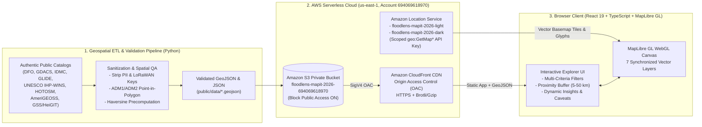

# System & AWS Cloud Architecture: FloodLens Ghana

## 1. Architectural Overview

**FloodLens Ghana** is architected as a static, serverless geospatial web application backed by a deterministic Python ETL pipeline and delivered globally via **Amazon CloudFront**, **Amazon S3**, and **Amazon Location Service**.

By precomputing spatial joins, coordinate validations, and baseline Haversine nearest-neighbor metrics during the build pipeline (`scripts/build_geospatial_datasets.py`), and pairing them with fast client-side geodesic buffer math (`src/utils/spatial.ts`) and WebGL vector rendering (`MapLibre GL JS`), the application achieves sub-second interactivity without requiring expensive always-on database servers or NAT gateways.

---

## 2. AWS Services & Resource Configuration

All AWS resources were provisioned in **`us-east-1`** under the dedicated **`Builder-challenges`** profile (`Account 694069618970`) using the isolated naming prefix **`floodlens-mapit-2026`**.

### 2.1 Amazon Location Service (Vector Basemap Engine)

- **Map Resources Created:**
  1. `floodlens-mapit-2026-light` (`arn:aws:geo:us-east-1:694069618970:map/floodlens-mapit-2026-light`): Configured with the `VectorOpenDataVisualizationLight` cartographic style (`RequestBasedUsage`), optimized for overlaying high-contrast hydrological and clinical data layers.
  2. `floodlens-mapit-2026-dark` (`arn:aws:geo:us-east-1:694069618970:map/floodlens-mapit-2026-dark`): Configured with `VectorOpenDataVisualizationDark` for low-light telemetry link inspection.
- **Least-Privilege API Key (`floodlens-mapit-2026-tile-key`):**
  - Scoped strictly to read-only map rendering actions: `geo:GetMapStyleDescriptor`, `geo:GetMapTile`, `geo:GetMapSprites`, and `geo:GetMapGlyphs`.
  - Restricted specifically to the two `floodlens-mapit-2026-*` map ARNs.
  - Restricted by HTTP Referer to `http://localhost:*`, `http://127.0.0.1:*`, and `https://*.cloudfront.net/*`.
  - Configured with an automatic expiration timestamp (`2026-12-01T00:00:00Z`) following the competition judging window.
- **Graceful Open Vector Failover:**
  - If an environment is run locally without an API key or behind a firewall blocking `maps.geo.us-east-1.amazonaws.com`, [`src/utils/mapStyles.ts`](../src/utils/mapStyles.ts) and [`src/components/GhanaMap.tsx`](../src/components/GhanaMap.tsx) automatically fall back to open MapLibre vector tiles (`Carto Positron / Dark Matter GL`) so the map never renders blank.

### 2.2 Amazon S3 (Private Static & Geospatial Data Origin)

- **Bucket Name:** `floodlens-mapit-2026-694069618970` (`us-east-1`)
- **Security Posture:**
  - `PublicAccessBlockConfiguration` is enabled across all four controls (`BlockPublicAcls=true`, `IgnorePublicAcls=true`, `BlockPublicPolicy=true`, `RestrictPublicBuckets=true`).
  - Access is granted exclusively to the Amazon CloudFront service principal (`cloudfront.amazonaws.com`) conditioned on the distribution ARN via an Origin Access Control (OAC) bucket policy.
- **Hosted Geospatial Catalog (`/data/`):**
  - `flood_events.geojson` (`116 KB`, 65 harmonized flood events)
  - `monitoring_stations.geojson` (`215 KB`, 253 river gauges and IoT nodes)
  - `iot_telemetry_links.geojson` (`5 KB`, 14 LoRaWAN radio propagation links)
  - `health_facilities.geojson` (`530 KB`, 1,226 hospitals and clinics)
  - `roads.geojson` (`199 KB`, 382 classified highway segments)
  - `admin_regions.geojson` (`75 KB`, 16 Regions with RP100 indicators)
  - `admin_districts_summary.json` (`94 KB`, 260 Districts with RP100 indicators)
  - `dataset_summary.json` (`11 KB`, national metrics and regional summaries)

### 2.3 Amazon CloudFront (Global Edge Delivery)

- **Origin Access Control (OAC):** Uses `sigv4` request signing (`signing-behavior: always`) to fetch assets from the private S3 bucket.
- **SPA Routing & Caching:**
  - Hashed JS/CSS bundles in `/assets/*` are served with long-lived immutable cache headers.
  - GeoJSON datasets in `/data/*` and `index.html` are compressed at the edge (`Compress: true`) for fast initial load even on mobile connections.

---

## 3. Frontend Application Architecture

| Module | File Path | Responsibility |
| :--- | :--- | :--- |
| **Application Shell & State** | [`src/App.tsx`](../src/App.tsx) | Parallel loading of the 7 GeoJSON/JSON assets, centralized filter/selection/layer state, error recovery, and responsive layout orchestration. |
| **WebGL Cartographic Engine** | [`src/components/GhanaMap.tsx`](../src/components/GhanaMap.tsx) | MapLibre GL JS integration with Amazon Location Service styles, 7 synchronized vector layers, clustered healthcare points, geodesic proximity buffer circle, nearest-neighbor connector lines, and interactive popups. |
| **Exploration & Analysis Panel** | [`src/components/SidePanel.tsx`](../src/components/SidePanel.tsx) | Four-tab analytical workbench (`Events`, `Inspector`, `Insights`, `Caveats`) with multi-criteria search/filtering, adjustable `5-50 km` proximity buffer controls, UNESCO LoRaWAN link table, and regional `RP100` exposure table. |
| **Spatial Math & Filtering** | [`src/utils/spatial.ts`](../src/utils/spatial.ts) | Pure TypeScript functions for Ghana coordinate validation, spherical Haversine distance, geodesic polygon generation, `1.35x-1.85x` road detour intervals, and dynamic insight aggregation. |
| **Amazon Location Style Resolver** | [`src/utils/mapStyles.ts`](../src/utils/mapStyles.ts) | Constructs Amazon Location Service style descriptor URLs (`maps.geo.us-east-1.amazonaws.com`) and manages basemap switching and fallback URLs. |
| **Methodology & Provenance Modal** | [`src/components/MethodologyModal.tsx`](../src/components/MethodologyModal.tsx) | Accessible dialog documenting dataset publishers, licenses, record counts, coordinate precision classes, and AWS architecture. |

---

## 4. Incremental Cost Analysis (Target: $< \$5.00$)

| AWS Service | Usage Model | Estimated Hackathon Usage | Estimated Cost (USD) |
| :--- | :--- | :--- | :--- |
| **Amazon Location Service** | `RequestBasedUsage` (`$0.04` per 1,000 map tile requests) | ~5,000 to 15,000 tile/descriptor requests | `$0.20 - $0.60` |
| **Amazon S3** | Standard Storage (`$0.023/GB-mo`) + GET requests (`$0.0004` per 1,000) | `< 5 MB` stored, ~5,000 GET requests | `< $0.01` |
| **Amazon CloudFront** | 1 TB data transfer + 10M HTTPS requests free tier / `$0.085/GB` | `< 1 GB` data transfer | `$0.00 - $0.09` |
| **Total Incremental Cost** | Serverless / Pay-per-request (zero idle compute) | Full weekend challenge + judging period | **`< $0.75` (Well below `$5.00` cap)** |
